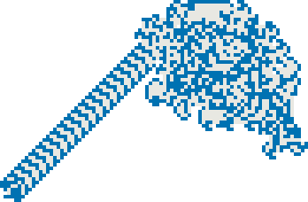

# langton-ga

**Distributed evolutionary search over generalized Langton ants (turmites).**
Rust · zero external dependencies · reproducible experiments · paper included.


`langton-ga` is a research testbed for a narrow question: **what does distribution buy when the search landscape is small, rugged, and deceptive?** It evolves generalized Langton ants with an asynchronous island-model genetic algorithm over TCP, records every generation, and ships the experiment suite and paper behind the numbers below.

Generalized Langton ants (*turmites*) are a useful stress test. A rule table of `S × C` entries defines a two-dimensional Turing machine; small changes flip the behaviour between a highway, a dense builder, a static weave, and chaos. For the default `2 × 3` configuration the search space is `18^6 ≈ 3.4 × 10^7` rules, small enough to explore seriously and large enough to be deceptive.

**Jump to:** [Status](#status) · [Results](#results-at-a-glance) · [Quick start](#quick-start) · [Reproduce](#reproduce-the-paper) · [Statistics](#statistics-current-vs-target) · [Roadmap](#roadmap-three-studies) · [Paper](#paper) · [Citation](#citation)

---

## Status

- **v0.1 — research prototype.** The paper snapshot is [`paper/main.pdf`](paper/main.pdf) (14 pages).
- **Validated:** simulator, classic highway detector, single-island GA, four-island TCP cluster, heterogeneous portfolio.
- **Known limits:** five seeds, one host, loopback TCP, no faults. The quality gain is small and not statistically significant. See [Limitations](#limitations-and-threats-to-validity).
- **Next:** at least 20 seeds with Wilcoxon tests, adaptive migration, and cellular/gossip topologies. See [Roadmap](#roadmap-three-studies).

## Why this exists

- **A controlled benchmark.** The same simulator, budget, and seeds are used to compare a sequential GA, a panmictic GA, and an island model. No framework noise, no hidden parallelism, no external solver.
- **A reusable distributed skeleton.** Independent island processes, an asynchronous TCP ring, top-k migration, telemetry, and CSV output in about 3k lines of dependency-free Rust.
- **A paper factory.** The repository is organized so each roadmap item — adaptive migration, topology comparison, stronger statistics — can become a paper without rewriting the core.

## Results at a glance

### Distributed comparison

Five seeds, four physical cores, one host, loopback TCP. `T = 10,000` steps per evaluation, 80 generations, weaver weights.

| Mode | Wall time (s) | Speedup | Evaluations | Final fitness | AUC | Late behavioural diversity |
|---|---:|---:|---:|---:|---:|---:|
| Sequential (1 thread) | 18.98 ± 1.09 | 1.00× | 20,322 | 0.714 ± 0.014 | 0.683 | 0.697 |
| Panmictic (4 threads) | 7.88 ± 1.47 | 2.41× | 20,322 | 0.714 ± 0.014 | 0.683 | 0.697 |
| Islands (4 × 64, g = 5) | 6.05 ± 1.11 | **3.14×** | 19,919 | **0.737 ± 0.012** | **0.711** | **0.899** |

Islands report 19,919 evaluations instead of 20,322 because elites are not re-evaluated. The island value is the best genome over the four islands.

**Read this before the numbers.** The 3.14× is wall-clock speedup with 78.4% parallel efficiency. The quality difference is +3.2% and is observed in 5/5 seeds, but with `n = 5` the exact paired permutation test cannot go below `p = 0.0625`. Treat it as a consistent trend, not a confirmed effect. The robust result is engineering: comparable or slightly better quality in roughly one third of the time, with much higher late-run behavioural diversity.

### Migration ablation

| Migration interval `g` | Final fitness | AUC | Late behavioural diversity | Wall time (s) | Control traffic (KB) |
|---:|---:|---:|---:|---:|---:|
| 0 (none) | 0.736 ± 0.008 | 0.703 | 0.869 | 5.51 | 14.2 |
| 5 | 0.737 ± 0.012 | 0.711 | 0.899 | 6.05 | 19.0 |
| 20 | 0.737 ± 0.012 | 0.702 | 0.877 | 5.95 | 15.2 |

Migration does **not** improve the best fitness: `p = 1.0` for `g = 0` vs `g = 5`, and `p = 0.5` for `g = 5` vs `g = 20`. The maximum over four islands is dominated by a few strong attractors (0.7445, 0.7291, 0.7258), so one island finding the attractor is enough. Migration changes diversity and traffic, not the maximum.

### Heterogeneous portfolio

Four islands, four weight profiles, no migration, 60 generations.

| Profile | Fitness (own weights) | Fitness (weaver weights) | Mobility | Density | Complexity | 3 × 3 neighbourhoods | Period / drift |
|---|---:|---:|---:|---:|---:|---:|---|
| mover | 0.633 | 0.211 | 0.7071 | 0.000 | 0.006 | 3 | 8 / (4, −4) |
| builder | 0.861 | 0.345 | 0.2000 | 1.000 | 0.010 | 5 | 10 / (0, 2) |
| weaver | 0.707 | 0.689 | 0.0014 | 0.445 | 1.000 | 1,548 | — |
| balanced | 0.484 | 0.336 | 0.3333 | 1.000 | 0.006 | 3 | 9 / (0, 3) |

The second fitness column re-evaluates each winner under the *weaver* weights. Only the weaver keeps a high value: the profiles are not cosmetic variations of one objective, they induce different regions of rule space.

### Classic baseline

The detector recovers the known Langton highway: period **104**, drift **(−2, 2)**, speed **0.0272 cells/step**, exact translated-pattern match **1.0000**, fitness **0.186** after 120,000 steps.

<p align="center">
  
  
</p>
<p align="center"><em>Left: chaotic phase at 12k steps. Right: the period-104 highway at 120k steps. Colour encodes visit count.</em></p>

## What is implemented

- **Simulator** — sparse chunked grid (32 × 32 chunks, unbounded coordinates), deterministic stepping, trajectories, ASCII and PNG rendering.
- **Genome** — `S × C` rule table; each entry stores `write`, `turn`, `next`; hex serialization with three bytes per entry.
- **Fitness** — four normalized signals (mobility, density, morphological complexity, colour usage) combined by configurable weights.
- **Genetic algorithm** — generational population, elitism, tournament selection, uniform crossover, per-field mutation, duplicate repair, scoped-thread evaluation.
- **Island model** — independent processes, TCP ring, asynchronous top-k migration, monitor, per-generation telemetry.
- **Highway detector** — candidate period and drift, verified by re-simulating to `t − p` and checking the translated pattern inside a radius-128 window.
- **Experiments** — shell suite, Python aggregator, LaTeX tables/macros, optimized figures.
- **Tests** — 22 unit and integration tests (`cargo test --release`).

## Quick start

### Prerequisites

- Stable Rust (edition 2021).
- Python 3.9+ for `scripts/make_report.py` (standard library only).
- LaTeX with `latexmk`, `booktabs`, `pgfplots`, and `natbib` (only to rebuild the paper).
- ImageMagick is optional; `make_report.py` falls back to true-colour copies.

### Build and test

```bash
# from the repository root
cargo build --release
cargo test --release
```

Expected: `22 passed`.

### 60-second demo

```bash
# 1. Classic ant: metrics and verified highway
./target/release/langton-ga analyze --rule classic --steps 120000

# 2. Render the chaotic and highway phases
./target/release/langton-ga render --rule classic --steps 12000 \
    --out /tmp/classic_12k.png --scale 4
./target/release/langton-ga render --rule classic --steps 120000 \
    --out /tmp/classic_120k.png --scale 3

# 3. One island, weaver profile
./target/release/langton-ga evolve --seed 1 --pop 64 --gens 30 --steps 10000 \
    --states 2 --colors 3 --threads 4 --weights 0.20,0.20,0.50,0.10 \
    --out /tmp/evo.csv --best-out /tmp/best.txt

# 4. Four-island cluster: monitor + 4 processes over loopback
./target/release/langton-ga demo --islands 4 --gens 40 --pop 64 --steps 10000 \
    --seed 1 --states 2 --colors 3 --weights 0.20,0.20,0.50,0.10 \
    --migration-interval 5 --base-port 8300 --out-dir /tmp/demo
```

The cluster writes `/tmp/demo/telemetry.csv`, `/tmp/demo/finals.csv`, one CSV and one preview PNG per island, and a `*_best.txt` summary for each island.

### CLI

| Command | Purpose |
|---|---|
| `sim` | Simulate one rule; optionally render, trace, or print ASCII. |
| `analyze` | Metrics and verified highway detection (period, drift). |
| `render` | High-resolution PNG of one rule. |
| `evolve` | Single-population GA, optionally multi-threaded. |
| `island` | One island of the distributed cluster (bind, peer, monitor). |
| `monitor` | Telemetry collector for the cluster. |
| `demo` | Launch monitor + N islands; supports heterogeneous profiles. |
| `bench` | Simulator throughput (steps/s). |

`langton-ga help` lists every option.

## Reproduce the paper

```bash
./scripts/run_experiments.sh
python3 scripts/make_report.py
cd paper && latexmk -pdf main.tex
```

- **Runtime:** about 5–10 minutes on eight cores. The sequential baseline is deliberately run one seed at a time so that wall-clock comparisons are fair.
- **Environment variables:** `SEEDS="1 2 3 4 5"`, `OUT=results`, `BIN=./target/release/langton-ga`.
- **Outputs:** `results/` (raw CSV/TXT/logs), `paper/data/` (aggregated series), `paper/tables/` (LaTeX), `paper/figs/` (optimized PNG).

### Determinism

| Artifact | Reproducibility |
|---|---|
| Simulator | Bitwise for a given genome and parameter set. |
| Single-population GA | Bitwise for a given seed. |
| Island cluster | Statistically reproducible, **not** bitwise: message arrival order depends on the OS. |
| Paper tables/figures | Regenerated from `results/` by `make_report.py`. |
| Benchmark | Machine-dependent; run `langton-ga bench` on your hardware. The script writes `results/bench.txt`, which is not committed. |

## Model in brief

### Genome

For `S` internal states and `C` colours, the genome is a table of `S × C` entries:

| Field | Range | Meaning |
|---|---|---|
| `write` | `0..C-1` | Colour written to the current cell. |
| `turn` | left / right / U | 90° left, 90° right, or 180° before moving. |
| `next` | `0..S-1` | Internal state for the next step. |

Each entry is serialized as three bytes in hexadecimal. The classic rule (`S = 2`, `C = 2`) is `010100000000000000000000`; the default `S = 2`, `C = 3` genome has 36 hex characters.

### Fitness

`F = w_m · M + w_ρ · D + w_κ · K + w_c · C`

| Component | Definition |
|---|---|
| Mobility `M` | Net displacement / steps. |
| Density `D` | New cells / bounding-box area. |
| Complexity `K` | Distinct 3 × 3 neighbourhoods / 512 (Bloom-filter estimate). |
| Colourfulness `C` | Colours used / colours available. |

| Profile | `w_m` | `w_ρ` | `w_κ` | `w_c` | Typical behaviour |
|---|---:|---:|---:|---:|---|
| mover | 0.80 | 0.05 | 0.05 | 0.10 | Fast diagonal glider. |
| builder | 0.05 | 0.75 | 0.10 | 0.10 | Dense quasi-1D band. |
| weaver | 0.20 | 0.20 | 0.50 | 0.10 | Complex static weave. |
| balanced | 0.50 | 0.25 | 0.15 | 0.10 | Intermediate conveyor. |

### Genetic algorithm

Generational population with two elites, tournament selection (`k = 3`), uniform crossover per table entry, mutation with probability `0.03` per field, random restart with `0.01`, genotypic duplicate repair, and scoped-thread evaluation.

### Island protocol

```
   ┌─────────┐  MIG   ┌─────────┐  MIG   ┌─────────┐  MIG   ┌─────────┐
   │ island 1│ ─────▶ │ island 2│ ─────▶ │ island 3│ ─────▶ │ island 4│
   └────┬────┘        └────┬────┘        └────┬────┘        └────┬────┘
        │ TEL              │ TEL              │ TEL              │ TEL
        └──────────────────┴────────┬─────────┴──────────────────┘
                                    ▼
                              ┌───────────┐
                              │  monitor  │  CSV: telemetry + finals
                              └───────────┘
```

Every `migration-interval` generations, each island sends its `migrants` best genomes to the next node. Arrivals are applied asynchronously at generation boundaries and replace the worst individuals while preserving elites. `--seed s` in `demo` maps to island `i` as `100s + i`, so replicates start from different populations and can be repeated; message arrival order is not deterministic. The wire protocol is plain text:

```text
MIG <island> <gen> <genome-hex>[,<genome-hex>...]
TEL <island> <gen> <best> <mean> <behavioural-diversity> <evaluations> <ms>
END <island> <best> <gen> <ms> <messages> <bytes>
```

### Highway detector

A highway is a space-time periodic pattern: there exist a period `p` and a drift `(dx, dy)` such that (i) the local state sequence repeats every `p` steps, (ii) the displacement per block is constant, and (iii) the pattern built at `t − p` reappears translated by `(dx, dy)` at `t`. The third condition is checked by re-simulating to `t − p` and comparing **every cell** in a radius-128 window. This separates a true highway from an accidental local recurrence and excludes the frozen transient near the origin.

## Repository map

```text
src/
  main.rs      CLI, commands, orchestration
  genome.rs    rule tables, mutation, crossover, hex
  grid.rs      sparse chunked grid, bbox, 3x3 neighbourhoods, embedding check
  sim.rs       simulator, trajectories, highway detection
  fitness.rs   four normalized objectives and weighted sum
  ga.rs        island GA, parallel evaluation, immigration
  net.rs       TCP protocol, listener, network metrics
  monitor.rs   telemetry collector
  png.rs       dependency-free PNG encoder (stored zlib blocks)
  render.rs    palette, crops, ASCII
scripts/
  run_experiments.sh   reproduces every experiment in the paper
  make_report.py       aggregates CSVs, writes LaTeX tables/macros/figures
paper/
  main.tex             paper (Spanish, bilingual abstract)
  refs.bib             bibliography
  main.pdf             14-page snapshot
  data/ tables/ figs/  generated inputs and assets
results/
  baseline/ single/ distributed/ portfolio/ gallery/
```

## Experimental protocol (paper snapshot)

| Parameter | Value |
|---|---|
| States × colours | `2 × 3` |
| Search space | `18^6 ≈ 3.4 × 10^7` rules |
| Steps per evaluation | 10,000 |
| Generations | 80 |
| Seeds | 5 |
| Sequential baseline | population 256, 1 thread |
| Panmictic baseline | population 256, 4 threads |
| Island model | 4 × 64, four processes, ring |
| Migration | top 2 every 5 generations (unless ablated) |
| Fitness weights | weaver `0.20, 0.20, 0.50, 0.10` |
| Hardware | 4 physical cores, one host, loopback TCP |
| Primary metrics | final best, AUC, late behavioural diversity |
| Secondary metrics | wall-clock, evaluations, control messages/bytes |
| Test | exact paired permutation, `n = 5` |

## Statistics: current vs target

The current paper reports exact paired permutation tests, all five seeds, and effect directions. That is appropriate for a first snapshot, but it is **not** enough for a confirmatory claim.

| Item | Paper (v0.1) | Target for extended studies |
|---|---|---|
| Seeds | 5 | ≥ 20, ideally 30 |
| Test | Exact paired permutation | Wilcoxon signed-rank, two-sided |
| Multiple comparisons | None | Holm–Bonferroni (or BH for exploratory) |
| Effect size | Mean difference and % | Rank-biserial correlation + bootstrap CI |
| Unit of analysis | Seed | Seed, paired by seed |
| Reporting | All seeds | All seeds, pre-registered hypotheses |
| Primary outcome | Final best | Pre-specified: final best or AUC |

**Changing the test does not fix `n = 5`.** For any exact two-sided paired test, the minimum attainable p-value is `2 / 2^n`:

| `n` | Minimum two-sided p |
|---:|---:|
| 5 | 0.0625 |
| 6 | 0.03125 |
| 10 | 0.00195 |
| 20 | 1.9 × 10⁻⁶ |
| 30 | 1.9 × 10⁻⁹ |

The floor is necessary but not sufficient: power still depends on the effect size. The extended study should pre-register the primary metric, run at least 20 seeds, report every seed, and interpret effect sizes rather than p-values alone.

## Roadmap: three studies

The core is deliberately separated from the experiments. Each track below can be implemented without changing the simulator or the genome.

### A. Adaptive migration

**Question.** Can migration be scheduled from measured heterogeneity instead of a fixed interval?

**Signal.** Per island and generation, compute:

- `H_fit`: coefficient of variation of fitness.
- `H_beh`: mean pairwise L1 distance between 3 × 3 neighbourhood histograms (already computed as behavioural diversity).
- `H_gen`: mean pairwise Hamming distance between rule tables, normalized by table length.
- `S`: generations since the island best last improved.

Combine them into a normalized index `H_t` (z-scores across islands, or a fixed weighted sum).

**Policy.** A simple baseline: if `H_t` is in the lowest quartile and `S ≥ 5`, migrate every 2 generations with 4 migrants; if `H_t` is in the highest quartile, migrate every 10 generations with 1 migrant; otherwise use the default 5/2. A proportional controller, `interval = clip(round(a − b·H_t), 1, 20)`, is the natural second arm.

**Design.** 4 × 64 islands, `T = 10,000`, 80 generations, at least 20 seeds. Arms: static `g = 0`, `g = 5`, `g = 20`, adaptive threshold, adaptive proportional. Match the total migration budget across arms, or report traffic and use it as a covariate. Metrics: final best, AUC, late behavioural diversity, time-to-0.70, messages, bytes, and migration payload.

**Success criterion.** Adaptive migration improves late diversity or AUC without reducing final best at equal or lower traffic, **or** improves final best with a pre-specified effect size.

**Implementation notes.** Add a `Heterogeneity` struct in `ga.rs`; extend telemetry with `het_fit`, `het_beh`, `het_gen`, `stagnation`, `policy_interval`, `policy_migrants`; add `--migration-policy static|adaptive`; test that the policy is deterministic for a fixed state.

### B. Topology: ring vs cellular vs gossip

**Question.** Does the interaction graph matter once population size, evaluation budget, and migration volume are held constant?

**Arms.**

1. **Ring** — current implementation: each island sends to the next.
2. **Cellular** — a 4 × 4 grid of islands, each sending to its four von Neumann neighbours.
3. **Gossip** — each island selects a random peer at every migration event.
4. **Complete** — all-to-all, or a random subset if traffic must be capped.
5. **Cellular GA** — a different family: one population on a 16 × 16 torus with local mating, no processes.

Keep total population at 256, the same `T`, the same number of generations, and the same number of migrants per event. For the cellular GA, report zero network traffic but keep it in the quality/time comparison.

**Metrics.** Final best, AUC, late behavioural diversity, time-to-threshold, wall-clock, messages, bytes, and convergence time. For multi-arm comparisons use Friedman + Nemenyi, or pairwise Wilcoxon with Holm correction.

**Implementation notes.** Add `--topology ring|grid|gossip|complete` to `demo`; generate peer lists from the topology; keep the monitor unchanged. The cellular GA belongs in `ga.rs` as a population structure, not in `net.rs`.

### C. Statistical rigor and multi-host execution

**Question.** Do the effects survive more replicates, real network conditions, and failures?

**Work items.**

- At least 20 seeds, pre-registered hypotheses, no optional stopping.
- Wilcoxon signed-rank with Holm correction, rank-biserial effect sizes, bootstrap confidence intervals.
- Multi-host runs (four machines or four containers) with `tc netem` latency and loss.
- Fault injection: kill one island mid-run and measure recovery, quality loss, and message overhead.
- Artifact archival: Zenodo DOI, pinned toolchain, and a CI job that rebuilds the paper.

**Success criterion.** A paper whose claims are supported by effect sizes and full distributions, with an artifact that a reviewer can rerun.

### Milestones

| # | Milestone | Status |
|---|---|---|
| M0 | Paper snapshot (v0.1) | ✅ |
| M1 | ≥ 20 seeds + Wilcoxon + effect sizes | ⏳ |
| M2 | Adaptive migration | ⏳ |
| M3 | Ring vs cellular vs gossip | ⏳ |
| M4 | Multi-host + fault injection | ⏳ |
| M5 | Zenodo DOI + archival artifact | ⏳ |

## Limitations and threats to validity

1. **Five seeds.** Low statistical power; the minimum exact two-sided p-value is 0.0625. The paper reports effect directions, not confirmatory tests.
2. **One host, four physical cores.** The speedup does not include real network latency or contention across machines.
3. **Loopback TCP.** The architecture is location-transparent, but multi-host behaviour was not measured.
4. **Control traffic includes telemetry.** One message per island per generation dominates the total; the migration payload is about 72 bytes per event.
5. **Complexity is a Bloom-filter estimate.** It is a proxy for morphological richness, not an exact count.
6. **Island runs are not bitwise reproducible.** Message arrival order depends on the operating system. Single-population runs are.
7. **Highway detector window.** Exact matching inside radius 128 can miss larger patterns.
8. **Island seeds differ from the baselines.** `demo` uses `100s + i`, while sequential and panmictic runs use `s`; paired comparisons by replicate index therefore use different random numbers.
9. **Fitness is a hypothesis.** The weighted sum encodes what "interesting" means. There is no ground-truth optimal rule, and different weights induce different optima.

## Reviewer FAQ

**Why only 3.14× on four cores?**
The cluster runs four island processes with 64 individuals each (one process per core in the paper configuration). By default `demo` keeps `--threads 1` inside each island, so the gain comes from running four processes; `--threads` additionally enables scoped-thread evaluation within an island. The run also pays for process startup, telemetry, and unequal finishing times. 78.4% efficiency is realistic for this granularity, not a theoretical ceiling.

**Is the quality gain real?**
Not at `n = 5`. It is +3.2% in 5/5 seeds, but the exact test floor is 0.0625. The defensible claim is engineering: comparable or slightly better quality in about one third of the time. The extended study will test the quality claim with at least 20 seeds.

**Why did migration do nothing?**
The cluster maximum is the maximum over four islands. A few strong attractors dominate the final outcomes, so one island finding the attractor is enough. Migration changes diversity and traffic, not the maximum. This is a structural result, not a bug.

**Is this really distributed?**
Yes at the process and protocol level: independent binaries, TCP connections, asynchronous messages, a separate monitor. It was validated on one host over loopback; multi-host execution is future work.

**Why no external crates?**
Reproducibility and portability. The RNG, PNG encoder, CSV writer, and TCP protocol are small, auditable, and have no supply-chain surface. The trade-off is that some utilities are intentionally minimal.

**Why a weighted sum instead of Pareto or quality-diversity?**
The weighted sum is a hypothesis-encoding device: each profile asks a different question about what makes a rule interesting. Pareto fronts and behavioural archives are the natural next step (see Track A and the discussion in the paper).

## Data and artifact policy

- **Committed:** `results/**/*.csv`, `*.log`, and the paper-run `*.txt` files (about 1.3 MB), plus `results/README.md` and `paper/{main.tex,refs.bib,main.pdf,data,tables,figs}` (about 1 MB).
- **Ignored:** `target/`, LaTeX auxiliary files, `results/bench.txt` (hardware-dependent, regenerated by the experiment script), and raw render PNGs (`results/**/*.png`, about 48 MB). The optimized copies used by the paper live in `paper/figs/`.
- **Why:** GitHub is not a binary store, and every ignored PNG is regenerable from a genome and a parameter set. See [`results/README.md`](results/README.md) for the layout and CSV semantics.
- **If you need the raw renders:** run `./scripts/run_experiments.sh`, or enable Git LFS and remove the ignore rule.

## Paper

The paper is a frozen snapshot of v0.1:

- [`paper/main.pdf`](paper/main.pdf) — 14 pages, Spanish with an English abstract.
- [`paper/main.tex`](paper/main.tex) — source.
- [`paper/refs.bib`](paper/refs.bib) — bibliography.

| Paper section | Code |
|---|---|
| Model and simulator | `src/genome.rs`, `src/grid.rs`, `src/sim.rs` |
| Fitness | `src/fitness.rs` |
| Genetic algorithm | `src/ga.rs` |
| Distributed architecture | `src/net.rs`, `src/monitor.rs` |
| Experiments and figures | `scripts/run_experiments.sh`, `scripts/make_report.py` |

The README is the living document; the paper is the citable snapshot.

## Citation

If you use this software, cite it using [`CITATION.cff`](CITATION.cff) or:

```bibtex
@software{barraza2026langtonga,
  author  = {Barraza Montenegro, Jose Pedro},
  title   = {langton-ga: Distributed Evolutionary Search over Generalized Langton Ants},
  year    = {2026},
  version = {0.1.0},
  license = {MIT},
  note    = {Research software; paper in paper/main.pdf}
}
```

## License

MIT. See [`LICENSE`](LICENSE).

Copyright © 2026 Jose Pedro Barraza Montenegro (JPBM).

## Contributing

- **Code:** open an issue or a PR with a focused change; run `cargo fmt` and `cargo test --release` before submitting.
- **Experiments:** open an issue with the hypothesis, the design, and the primary metric *before* running a large sweep. Add a script and update the results table.
- **Dependencies:** zero external crates is a feature. If you need one, explain why in the PR.
- **Data:** do not commit raw PNGs or `target/`; see the data policy above.
